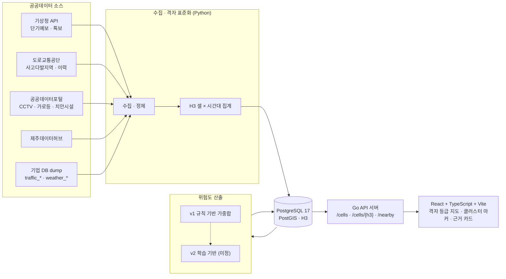
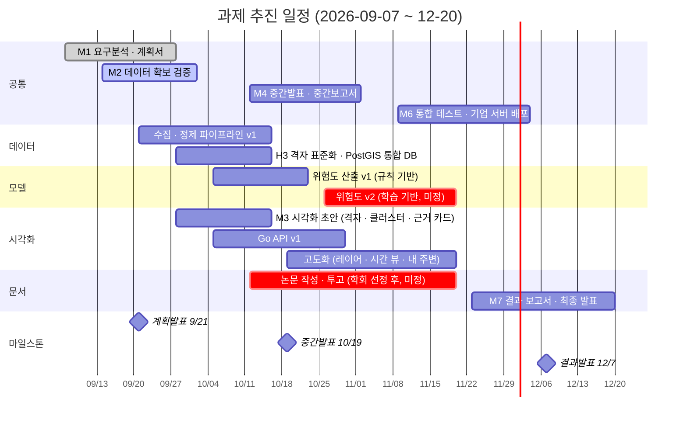

# 제주 안전지도 · 공공데이터 기반 위험도 산출 및 안전 분석 시각화

경북대학교 컴퓨터학부 **종합설계프로젝트1 (2026-2, 004분반)** · (주)제윤메디컬 산학협력 과제

> 여행객이 "지금 있는 곳이 얼마나 안전한지"를 **근거와 함께** 볼 수 있는 격자 기반 안전 분석 웹앱.
> 기업 서비스 위에 얹지 않고 팀이 별도 웹앱으로 개발하며, 검증된 부분은 기업이 이후 마이그레이션을 검토한다.

## 산책 코스 실행 및 사용법

### 로컬 실행

1. 카카오디벨로퍼스 앱에서 **앱 → 플랫폼 키**로 이동해 **JavaScript 키**와 **REST API 키**를 확인합니다. **카카오맵 → 사용 설정 → 상태**를 **ON**으로 바꾸고, JavaScript 키의 **JavaScript SDK 도메인**에 `http://localhost:8080`을 등록합니다. [카카오맵 설정 안내](https://developers.kakao.com/docs/ko/kakaomap/common)
2. 처음 설정할 때 [환경 변수 예시](backend/.env.example)를 `backend/.env`로 복사합니다. `KAKAO_MAP_JS_KEY`에 JavaScript 키를, `KAKAO_MAP_REST_KEY`에 REST API 키를 입력합니다. `.env`는 Git에서 제외됩니다.
3. Docker를 실행하고 저장소 루트에서 아래 명령으로 DB와 Go 서버를 시작합니다. 키를 수정한 경우에는 실행 중인 Go 서버를 종료한 뒤 다시 시작합니다.

   ```bash
   cd backend
   docker compose up -d --wait db
   set -a
   source ./.env
   set +a
   SERVER_ADDR=127.0.0.1:8080 go run ./cmd/server
   ```

### 코스 만들기

1. 격자 지도 오른쪽 위 **산책 코스**를 누르거나 <http://localhost:8080/walk>를 엽니다.
2. 출발지와 도착지를 장소명·도로명주소로 검색하거나 지도에서 클릭해 지정합니다. **+ 경유지 추가**로 중간 지점을 최대 5개 넣을 수 있습니다.
3. 경유지와 도착지 옆 **⠿** 손잡이를 위아래로 드래그해 방문 순서를 바꿉니다. 손잡이에 초점을 두고 위·아래 방향키로도 이동할 수 있습니다. 출발지는 고정되고 맨 아래 지점이 도착지가 됩니다.
4. **도보 경로 찾기**를 눌러 경로선, 총 거리, 예상 소요 시간을 확인합니다. 순서를 바꾼 뒤 같은 버튼을 다시 누르면 새 경로를 조회합니다.

격자 데이터 준비 방법은 [백엔드 실행 안내](backend/ROADMAP.md#실행-방법)에 있습니다.

## 지도 표현 목업 실행

제주 안전지도의 지도 표현을 비교하는 **정적 HTML 목업 3개**를 보려면 저장소 루트에서 아래 명령을 실행한 뒤 브라우저에서 각 주소를 여세요. Python 3으로 실행할 수 있습니다.

```bash
python3 -m http.server 8765
```

| 화면 | 실행 주소 | 내용 |
| --- | --- | --- |
| [지역별 위험 점수](mockups/01-score-map.html) | <http://localhost:8765/mockups/01-score-map.html> | 읍면동 및 확대 시 리·동 단위 예시 위험 점수 |
| [기상 위험장](mockups/02-weather-field.html) | <http://localhost:8765/mockups/02-weather-field.html> | 강수·강풍의 연속적인 예시 영향 범위 |
| [안전 자원 분포](mockups/03-safety-elements.html) | <http://localhost:8765/mockups/03-safety-elements.html> | 경찰·소방·편의점 자료의 유형별 분포 |

각 화면의 조작 방법, 데이터 출처와 한계는 [목업 설명](mockups/README.md)에 정리했습니다. 1·2번의 위험 수치와 기상 값은 예시이며, 3번의 경찰·소방 점은 개략 위치입니다. 현재 화면은 아래에 적힌 계획 단계의 React·Go 서비스와 연동되지 않았습니다.


## 팀

| 역할 | 이름 |
|---|---|
| 팀장 · 기업/교수 소통 · 문서 | 김동우 |
| 팀원 | 이민환 · 서예은 · 안동균 · 배병윤 |
| 담당교수 | 권영우 교수 |
| 기업 멘토 | 이대규 책임연구원 (제윤메디컬 기술연구소 · 제주지사 제노바이츠) |

## 확정 상태 표기

- `[확정]` 멘토 QnA(9/17) 또는 수업 OT에서 명시된 사항
- `[검토 중]` 팀이 반영하려 하지만 아직 확보·검증되지 않은 사항
- `[미정]` 팀 협의 또는 멘토 확인 후 정할 사항

## 시스템 구성 (안)



## 기술 스택

| 구분 | 선택 | 근거 |
|---|---|---|
| 백엔드 | Go 1.23 · chi(HTTP 라우터) · pgx · h3-go | 별도 웹앱이므로 팀이 선택 `[검토 중]` |
| 프론트 | React 19 · TypeScript · Vite · TanStack Query · Tailwind CSS | 기업 스택(React/Vite) + 현행 웹앱 관행 |
| 지도 | Kakao Maps SDK (일 10만 건 무료) · 격자 레이어 렌더러 `[미정]` | 기업 사용 중 |
| DB | PostgreSQL 17 · PostGIS · H3 | 기업 스택과 동일, dump 호환 `[확정]` |
| 협업 | GitHub(코드·회의록) · Notion(문서·일정) · KakaoTalk(멘토 소통) · Zoom(회의) | 수업 요건 + 멘토 협의 |
| 파이프라인 | Python 3.12 · Pandas · scikit-learn · h3-py | 기업 스택과 동일 |
| 인프라 | Docker Compose · GitHub Actions | 로컬 개발 → 기업 서버 테스트 `[확정]` |

## 마일스톤

| # | 마일스톤 | 기한 | 학교 일정 |
|---|---|---|---|
| M1 | 계획 및 요구분석 | 9/28 | 9/21 계획발표 · 9/28 계획서 |
| M2 | 데이터 확보 검증 | 10/2 | — |
| M3 | 시각화 초안 · 위험도 v1 | 10/16 | 멘토 요청: 10월 중순 초안 |
| M4 | 중간발표 · 중간보고서 | 11/2 | 10/19 중간발표 · 11/2 보고서 |
| M5 | 고도화 · 논문 투고 | 11/20 | — |
| M6 | 통합 · 배포 · 결과발표 | 12/7 | 12/7 결과발표 |
| M7 | 결과보고서 · 실적 제출 | 12/20 | 12/20 제출 |

기한은 [Milestones](../../milestones)에 등록되어 있다.



## 기업 소통 이력

| 일자 | 내용 |
|---|---|
| 9/9 | 팀장 → 멘토 인사 메일 (팀 구성, 과제 이해, 질문 5개) · 당일 멘토 서면 답변 |
| 9/16 | 카카오톡 단체방 개설(팀원 5 + 멘토) · 사전 질문지 6개 항목 공유 · 9/17 Zoom 확정 |
| 9/17 | 1차 온라인 미팅(Zoom): QnA 문서 답변, 기업 사업소개·시연 영상 공유 · DB dump 요청 및 수령 |
| 9/18 | dump 링크 재수령 · 팀 내 공유 |

회의록: [docs/meetings](docs/meetings) · 데이터 출처 검증표: [docs/data/sources.md](docs/data/sources.md)

## 저장소 구조

```
backend/    Go API 서버
frontend/   React + TypeScript + Vite
pipeline/   Python 수집 · 격자 집계 · 위험도 산출
docs/       회의록 · 데이터 명세 · 보고서
mockups/    정적 HTML 지도 표현 목업 3개와 로컬 지도 자산
```

`backend/`, `frontend/`, `pipeline/`은 예정 구조이며 현재 저장소에는 `docs/`와 `mockups/`가 있습니다.
## 과제 추진 및 개발 일정
gantt
    title 과제 추진 및 개발 일정
    dateFormat YYYY-MM-DD
    axisFormat %m-%d

    section 핵심 마일스톤
    발표                  :milestone, m1, 2026-09-21, 0d
    수행계획서 제출        :milestone, m2, 2026-09-28, 0d
    중간발표              :milestone, m3, 2026-10-19, 0d
    중간 보고서 제출       :milestone, m4, 2026-11-02, 0d
    결과발표              :milestone, m5, 2026-12-07, 0d
    결과보고서 및 실적 제출 :milestone, m6, 2026-12-20, 0d

    section 5단계 개발 절차
    01 요구사항 분석 및 구현계획    :active, t1, 2026-09-01, 2026-09-28
    02 모델 설계 및 데이터 수집     :t2, 2026-09-29, 2026-10-15
    03 데이터 실증                 :t3, 2026-10-16, 2026-11-02
    04 UI 설계 및 시각화 구현       :t4, 2026-11-03, 2026-11-25
    05 결과물 산출 및 피드백        :t5, 2026-11-26, 2026-12-20

